  

# 🚀 Awesome Command Line Navigation ⚡

  
  
  
  
  
  

---

## 🧭 Curated Directory Jumping, Interactive Fuzzy Finding & Shell History Search Stack

> **A production-grade, SEO-optimized directory of modern CLI tools, intelligent directory jumpers, fuzzy finders, terminal file managers, and cloud-integrated developer terminal platforms.**

*Last updated: October 2026* ⚡

Welcome to the definitive ecosystem guide for **Command Line Navigation**! This repository tracks premier **SaaS & cloud-connected terminal platforms** alongside high-performance **open-source GitHub projects**. These tools enable engineers, DevOps practitioners, sysadmins, and terminal power-users to traverse deeply nested filesystems at the speed of thought—replacing standard `cd` and `ls` with frecency-ranked directory jumps, fuzzy interactive filtering, blazing-fast file managers, and cross-machine synchronized shell history.

---

## 📑 Table of Contents

- [📊 Sector Overview & Market Dynamics](#-sector-overview--market-dynamics)
- [☁️ SaaS & Hosted Terminal Platforms](#️-saas--hosted-terminal-platforms)
- [📦 Open-Source GitHub Projects](#-open-source-github-projects)
  - [🏆 Category Leaders & Top Starred Tools](#-category-leaders--top-starred-tools)
  - [⚡ Essential Companion CLI Navigation Utilities](#-essential-companion-cli-navigation-utilities)
- [💡 Modern Navigation Stack Architecture](#-modern-navigation-stack-architecture)
- [📈 Star History](#-star-history)
- [💖 Support & Sponsorship](#-support--sponsorship)
- [🤝 How to Contribute](#-how-to-contribute)
- [⚖️ Disclaimer & Insights](#️-disclaimer--insights)

---

## 📊 Sector Overview & Market Dynamics

The global software development tools and terminal emulator ecosystem is currently valued between **$6.4B and $10.8B**, projected to surpass **$16B+ by 2030** with an approximate 13–16% CAGR driven by cloud infrastructure proliferation and AI-assisted workflows. 

The sector exhibits a **moderately fragmented market structure**: while low-level shell utilities remain a decentralized, vibrant open-source playground where no single tool monopolizes workflow preference, cloud-connected AI terminal platforms are increasingly consolidating around venture-backed incumbents with strong collaborative features and proprietary model integrations.

---

## ☁️ SaaS & Hosted Terminal Platforms

The following SaaS and hosted terminal platforms provide cloud synchronization, team collaboration vaults, centralized AI command assistance, and intelligent workflow navigation.

| Platform / Company | Company Size / Valuation / Revenue | Pricing | Free Tier Limits | Key Navigation & Terminal Features |
| :--- | :--- | :--- | :--- | :--- |
| **[Warp](https://www.warp.dev/)** | **~$300M Valuation** ($73M+ VC raised) | **$20/user/month** (Build tier; $45/user/month Business) | **Free forever**: Full native terminal, Warp Agent CLI access, 100 AI credits/mo, Bring Your Own Key (BYOK) support, community support | AI-native terminal in Rust with command auto-completion, directory bookmarks, Warp Drive shared workflows, and natural language command navigation. |
| **[Termius](https://www.termius.com/)** | **~$30M–$50M Est. Valuation** ($2.7M Seed, Bootstrapped Growth) | **$10/user/month** (Pro tier; $20/user/month Team) | **Free forever (`Starter`)**: Single local vault, 0 cloud sync across devices, local SSH/SFTP/Telnet access, no multi-device synchronization | Cross-platform terminal & SSH client featuring snippet autocomplete, interactive directory navigation, port forwarding, and team vault access. |
| **[MobaXterm](https://mobatek.net/)** (Mobatek) | **~$10M–$20M Est. Valuation** (Profitable Bootstrapped SMB) | **$69/user** (Professional Edition perpetual license with 12 months updates) | **Free forever (`Home Edition`)**: Max 12 saved sessions, max 2 SSH tunnels, max 4 macros, network daemons runtime capped at 360 seconds | All-in-one Windows terminal emulator with enhanced X11 server, tabbed SSH client, integrated graphical SFTP file tree browser, and directory bookmarks. |

---

## 📦 Open-Source GitHub Projects

Below are the most acclaimed open-source terminal navigation utilities, ranked strictly in descending order of GitHub stargazers.

### 🏆 Category Leaders & Top Starred Tools

| Project | GitHub_Stars | License | Description & Navigation Strengths |
| :--- | :--- | :--- | :--- |
| **[fzf](https://github.com/junegunn/fzf)** |  | `MIT` | **A general-purpose interactive command-line fuzzy finder.** Powers interactive directory jumping (`ALT-C`), contextual file searching (`CTRL-T`), command history retrieval (`CTRL-R`), and integrates seamlessly with `zoxide`, `git`, and `neovim`. |
| **[yazi](https://github.com/sxyazi/yazi)** |  | `MIT` | **Blazing fast terminal file manager written in Rust, based on async I/O.** Features asynchronous file loading, built-in code and full-resolution Kitty/Sixel graphics preview, and Vim-style navigation. |
| **[zoxide](https://github.com/ajeetdsouza/zoxide)** |  | `MIT` | **A smarter, faster `cd` command that tracks your most used directories.** Uses a frecency ranking algorithm (frequency + recency) with ~5ms startup. Features interactive `zi` selection via `fzf` and imports data from `autojump`, `z`, and `fasd`. |
| **[zellij](https://github.com/zellij-org/zellij)** |  | `MIT` | **A modern terminal workspace and multiplexer with batteries included.** Provides seamless pane and tab navigation, built-in status layout, file search integration, and WebAssembly plugin architecture. |
| **[atuin](https://github.com/atuinsh/atuin)** |  | `MIT` | **Magical shell history.** Replaces default history with an indexed SQLite database recording working directory, duration, exit codes, and timestamps. Features end-to-end encrypted shell history synchronization across machines. |
| **[nnn](https://github.com/jarun/nnn)** |  | `BSD-2-Clause` | **The ultra-lightweight, blazing fast orthodox terminal file manager.** Extremely low memory footprint (~3.5MB), instant disk navigation, batch file operations, and extensive plugin system. |
| **[ranger](https://github.com/ranger/ranger)** |  | `GPL-3.0` | **A VIM-inspired console file manager.** Multi-column Miller columns layout for rapid tree traversal, cooperative file previews, and deep shell integration. |
| **[z (rupa/z)](https://github.com/rupa/z)** |  | `WTFPL` | **The original lightweight directory jumper script.** Tracks frecent paths with a zero-dependency POSIX/bash/zsh shell script; the conceptual ancestor to `zoxide`. |
| **[autojump](https://github.com/wting/autojump)** |  | `GPL-3.0` | **A `cd` command that learns.** Classic Python-based directory jumper maintaining a database of frequently accessed paths for quick keyword jumping. |
| **[broot](https://github.com/Canop/broot)** |  | `MIT` | **A new way to see and navigate directory trees.** Renders balanced directory tree views fitting your terminal screen without infinite scrolling, featuring instant fuzzy filtering and shortcuts. |
| **[peco](https://github.com/peco/peco)** |  | `MIT` | **Simplistic interactive filtering tool.** Clean Go-based interactive selection tool for pipes, processes, and command line navigation pipelines. |
| **[mcfly](https://github.com/cantino/mcfly)** |  | `MIT` | **Fly through your shell history with a neural network.** Upgrades `CTRL-R` with an intelligent ranking algorithm that considers current directory, recent commands, and execution frequency. |
| **[skim](https://github.com/skim-rs/skim)** |  | `MIT` | **Fuzzy Finder written in Rust.** A high-performance, multithreaded alternative to `fzf` with full POSIX shell integration and native Rust library bindings. |
| **[fasd](https://github.com/clvv/fasd)** |  | `MIT` | **Command-line productivity booster for quick access to files and directories.** Ranks both files and folders using frecency for rapid opening with editors or paging utilities. |
| **[z.lua](https://github.com/skywind3000/z.lua)** |  | `MIT` | **A blazing fast cd command powered by Lua.** Optimized for POSIX shells, Windows PowerShell, and fish; ideal for Neovim/Lua-centric command line environments. |
| **[jump](https://github.com/gsamokovarov/jump)** |  | `MIT` | **Jump helps you navigate faster by learning your habits.** Single-binary directory jumper written in Go with fuzzy matching and shell integrations. |

---

### ⚡ Essential Companion CLI Navigation Utilities

Pair your directory jumpers with these top-tier command-line exploration and search tools:

| Tool | GitHub_Stars | Description |
| :--- | :--- | :--- |
| **[fd](https://github.com/sharkdp/fd)** |  | Simple, fast, and user-friendly alternative to `find` with colorized output and regex support. |
| **[delta](https://github.com/dandavison/delta)** |  | A syntax-highlighting pager for git, diff, and grep output that transforms navigation through diffs. |
| **[eza](https://github.com/eza-community/eza)** |  | A modern, maintained replacement for `ls` with Git status integration, tree views, and icons. |
| **[fzf-marks](https://github.com/urbainvaes/fzf-marks)** |  | Bash/Zsh plugin for managing directory bookmarks via interactive `fzf` menus. |

---

## 💡 Modern Navigation Stack Architecture

For the ultimate terminal speed and developer ergonomics, combine:
1. **Directory Jumping**: `zoxide` (instant jump to frecent paths)
2. **Fuzzy Search & Interactive Selection**: `fzf` (fuzzy search files, git commits, processes)
3. **Shell History Persistence & Sync**: `atuin` (SQLite-backed history search across all devices)
4. **Visual Tree Exploration**: `broot` or `yazi` (instant high-performance file management)
5. **Modern Listing**: `eza` and `fd` (enhanced file finding and directory tree visualization)

---

## 📈 Star History

---

## 💖 Support & Sponsorship

Thank you for exploring and bookmarking **Awesome Command Line Navigation**! 🌟

If this curated collection helped streamline your developer workflow or save you time in the terminal, please consider:
- ⭐ **Starring this repository** to help other developers discover it!
- 🍴 **Forking and sharing** it with your developer community.
- ☕ **Buying a coffee & sponsoring ongoing maintenance**:  
  👉 **[Support on GitHub Sponsors Dashboard](https://github.com/sponsors/ishandutta2007)**

---

## 🤝 How to Contribute

We welcome additions, corrections, and tool suggestions!

1. 🍴 **Fork** this repository.
2. 🌿 Create your feature branch (`git checkout -b feature/add-new-tool`).
3. 📝 Update `README.md` following the tabular layout, including license, stars, and factual descriptions.
4. 🚀 Commit your changes (`git commit -m "feat: add <tool-name> to navigation list"`).
5. 📬 Push to the branch and open a **Pull Request**.

---

## ⚖️ Disclaimer & Insights

- This repository is a **community-curated collection** provided for educational and productivity purposes.
- When configuring cloud-synced shell history or network tools (e.g., Atuin, Warp, Termius), verify your organization's security posture and ensure end-to-end encryption keys remain confidential.
- **Migration Note**: If you are still relying on legacy `autojump` or `fasd`, modern alternatives like `zoxide` offer ~10x faster startup performance (~5ms), full cross-shell compatibility, and automated database import scripts (`zoxide import autojump`).

---

  <b>Built with ❤️ for developers, DevOps engineers, and terminal enthusiasts worldwide.</b>

